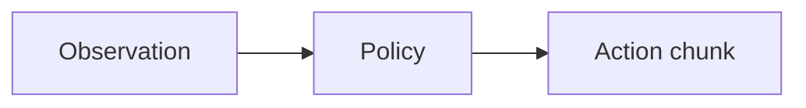

# How to Add a Chapter
{: .no_toc }

Everything on this site is a markdown file. To add content you create a file, write a few lines of front matter at the top, and the sidebar, search, previous and next buttons and dark mode all update by themselves.

1. TOC
{:toc}

## Where things live

```text
.
├── _config.yml                 site title, author, GitHub links
├── index.md                    home page and the chapter cards
├── chapters/
│   ├── _TEMPLATE.md            copy this to start a page
│   ├── 01-imitation-learning/
│   │   ├── index.md            chapter landing page (has_children: true)
│   │   └── multimodality.md    section 1.1 (parent: "1. Imitation Learning")
│   └── 02-diffusion-models/ ...
├── appendix/                   this guide and the references
├── assets/media/<chapter>/     images, gifs and videos
├── _includes/code/             runnable code shown in the book
└── scripts/
    ├── new_page.py             creates chapter or section files for you
    └── make_figures.py         regenerates every figure from the code
```

## Fastest way: the helper script

From the repository root, in WSL or any terminal with Python 3:

```bash
python scripts/new_page.py chapter "Model Predictive Control"
python scripts/new_page.py section 7 "MPPI from Scratch"
```

The first command creates `chapters/07-model-predictive-control/index.md` with the right number and order. The second adds `chapters/07-model-predictive-control/mppi-from-scratch.md` as section 7.1 under it, and creates `assets/media/ch07/` for its images. Open the new file and start writing.

## Doing it by hand

### A new chapter

Make a folder under `chapters/` and put an `index.md` in it.

```yaml
---
title: "7. Model Predictive Control"
nav_order: 8
has_children: true
---
```

`nav_order` controls the position in the sidebar. Home is 1, Chapter 1 is 2, so Chapter $$n$$ uses $$n + 1$$. The appendix uses 90 so new chapters always appear above it.

### A section inside a chapter

Add any `.md` file to the chapter folder.

```yaml
---
title: "7.1 MPPI from Scratch"
parent: "7. Model Predictive Control"
nav_order: 1
---
```

{: .warning }
> `parent` must match the chapter's `title` **exactly**, including the number, the full stop and the capital letters. If it does not match, the page will not appear in the sidebar.

### Optional front matter

| Key | Effect |
|:--|:--|
| `math: false` | Skip loading MathJax on a page without equations |
| `nav_exclude: true` | Hide the page from the sidebar |
| `has_toc: false` | Hide the automatic list of child pages on a chapter page |
| `last_modified_date: 2026-11-15` | Show "Page last modified" in the footer |

## Writing content

### Headings and a table of contents

Use `#` for the page title and `##` for sections. Put this right under the title to get an automatic table of contents.

```markdown
# 7.1 MPPI from Scratch
{: .no_toc }

1. TOC
{:toc}
```

### Math

Write LaTeX between double dollar signs. On its own line with blank lines around it, it becomes a display equation. Inside a sentence it stays inline.

```latex
The cost is $$J = \sum_t c(\mathbf{x}_t, \mathbf{u}_t)$$ for a rollout.

$$
\mathbf{u}^\star = \sum_i w_i\, \mathbf{u}^{(i)}, \qquad w_i \propto \exp\!\left(-\tfrac{1}{\lambda} J^{(i)}\right)
\tag{7.1}\label{eq:mppi}
$$

Equation \eqref{eq:mppi} is the MPPI update.
```

These shortcuts are defined on every page. `\E`, `\R`, `\N`, `\bx`, `\ba`, `\bo`, `\bA`, `\bO`, `\beps`.

{: .note }
> Avoid two opening curly braces in a row, as in `{{`, anywhere in a page. The site generator reads them as a template command. Add a space, `{ {`, which LaTeX ignores.

### Code

Use fenced code blocks with a language name. Every block gets syntax highlighting and a copy button.

````markdown
```python
import torch

def mppi_step(u, costs, lam=1.0):
      w = torch.softmax(-costs / lam, dim=0)
      return (w[:, None, None] * u).sum(0)
```
````

To show a whole runnable file, put it in `_includes/code/` and include it. The page then always shows the current version of the file, with its filename and a link to GitHub.

```liquid

```

### Images and GIFs

Put the file in `assets/media/ch07/` and include it. GIFs work the same way as PNGs.

```liquid
{% include figure.html src="/assets/media/ch07/rollouts.gif" alt="MPPI rollouts" caption="Sampled rollouts, coloured by cost." width="80%" %}
```

Plain markdown also works if you do not need a caption: ``.

### Videos

Local MP4 or WebM files, or YouTube.

```liquid



```

{: .note }
> Keep videos under about 20 MB. GitHub rejects files over 100 MB. To shrink a screen recording run `ffmpeg -i in.mov -vf scale=1280:-2 -c:v libx264 -preset veryfast -crf 26 -an out.mp4`.

### Callout boxes

Put a class line directly above a quote block.

```markdown
{: .key }
> The main takeaway of the section.
```

| Class | Title shown | Use for |
|:--|:--|:--|
| `.definition` | Definition | Formal definitions |
| `.intuition` | Intuition | Informal explanations |
| `.key` | Key idea | The one thing to remember |
| `.warning` | Pitfall | Bugs and traps |
| `.exercise` | Exercise | Things for the reader to try |
| `.note` | Note | Side remarks |

You can add more in `_config.yml` under `callouts`.

### Diagrams

Mermaid diagrams are drawn from text.

````markdown

````

### Tables

Standard markdown tables. A colon on the left of the dashes aligns left, on both sides centres.

```markdown
| Method | Steps | Success |
|:--|:--:|:--:|
| DDPM | 100 | 45/50 |
```

## Previewing locally

In WSL Ubuntu, install Ruby once.

```bash
sudo apt update && sudo apt install -y ruby-full build-essential zlib1g-dev
echo 'export GEM_HOME="$HOME/gems"' >> ~/.bashrc
echo 'export PATH="$HOME/gems/bin:$PATH"' >> ~/.bashrc
source ~/.bashrc
gem install bundler
```

Then, from the repository root:

```bash
bundle install
bundle exec jekyll serve --livereload
```

Open <http://localhost:4000>. Pages rebuild when you save. Changes to `_config.yml` need a restart.

## Publishing

Push the repository to GitHub, open **Settings, Pages**, and set **Source** to **GitHub Actions**. The workflow in `.github/workflows/pages.yml` builds and publishes the site on every push to `main`. If the site lives at `username.github.io/repo-name`, set `baseurl: "/repo-name"` in `_config.yml`.

## Regenerating figures

Every figure in Chapters 1 to 4 comes from `scripts/make_figures.py`. After changing the code, rebuild them all or just one group.

```bash
python scripts/make_figures.py          # everything, several minutes on CPU
python scripts/make_figures.py bc dp    # only the BC and Diffusion Policy figures
```
