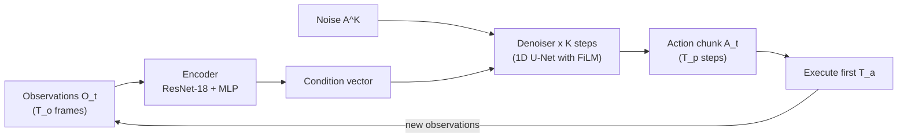

# 3. Diffusion Policy
{: .no_toc }

Prerequisites: Chapters 1 and 2

1. TOC
{:toc}

## From images to actions

Diffusion Policy [1] applies the machinery of Chapter 2 to a conditional distribution. The sample is an action chunk and the condition is a short history of observations.

$$
\mathbf{A}_t = (\mathbf{a}_t, \dots, \mathbf{a}_{t+T_p-1}),
\qquad
\mathbf{O}_t = (\mathbf{o}_{t-T_o+1}, \dots, \mathbf{o}_t),
\qquad
\pi_\theta(\mathbf{A}_t \mid \mathbf{O}_t)
$$

The only change to the loss is that the noise predictor also sees $$\mathbf{O}_t$$.

$$
\mathcal{L}(\theta) = \E_{(\mathbf{O}_t, \mathbf{A}_t^0) \sim \mathcal{D},\; k,\; \boldsymbol\epsilon}\Big[\big\lVert \boldsymbol\epsilon - \boldsymbol\epsilon_\theta\big(\sqrt{\bar\alpha_k}\,\mathbf{A}^0_t + \sqrt{1-\bar\alpha_k}\,\boldsymbol\epsilon,\; k,\; \mathbf{O}_t\big)\big\rVert^2\Big]
$$

Sampling starts from Gaussian noise $$\mathbf{A}^K_t$$ and applies the reverse step $$K$$ times with $$\mathbf{O}_t$$ held fixed. The observation is encoded once per control step, not once per denoising step, which keeps inference affordable.

## Three horizons

Diffusion Policy has three time windows. Getting them right matters more than most architecture choices.

| Symbol | Name | Typical value [1] | Role |
|:--|:--|:--:|:--|
| $$T_o$$ | observation horizon | 2 | How many past frames the policy sees |
| $$T_p$$ | prediction horizon | 16 | Length of the generated action chunk |
| $$T_a$$ | action horizon | 8 | How many actions are executed before replanning |

The chunk is indexed so that its first element lines up with the oldest observation. The executed actions are therefore $$\mathbf{a}_{t}, \dots, \mathbf{a}_{t+T_a-1}$$, which sit at chunk positions $$T_o - 1$$ to $$T_o + T_a - 2$$. The earlier positions describe actions that were already taken. They are predicted only to give the model a consistent target.

## Receding horizon control

The execution loop is model predictive control with a learned planner. Predict $$T_p$$ steps, execute $$T_a$$ of them, observe, predict again. The two extremes both fail.

- $$T_a = 1$$ replans every step. Consecutive samples can come from different modes, so the robot jitters between them. This is the multimodal version of the compounding error from Chapter 1.
- $$T_a = T_p$$ never reacts within a chunk. The robot cannot correct for disturbances or contact surprises.

Chi et al. report that $$T_a = 8$$ with $$T_p = 16$$ balances commitment and reactivity across their benchmarks [1]. Section 3.1 shows the mode switching problem on our toy task.

## Conditioning by FiLM

There are two ways to condition a denoiser. One is to treat observations as part of the sample and inpaint them. The other is to feed them as a side input. Diffusion Policy uses the second, through **feature-wise linear modulation** (FiLM) [2]. Every residual block computes a per channel scale and bias from the condition vector $$\mathbf{c}$$ and applies them to its feature map $$\mathbf{h}$$.

$$
\mathrm{FiLM}(\mathbf{h} \mid \mathbf{c}) = \gamma(\mathbf{c}) \odot \mathbf{h} + \beta(\mathbf{c})
$$

Here $$\mathbf{c}$$ concatenates the diffusion step embedding and the observation features. Because every block is modulated, the condition cannot be ignored. Section 3.1 shows what goes wrong when the condition is a weak extra input instead.

## Network choices

Chi et al. compare two denoisers [1].

| | CNN (1D temporal U-Net) | Transformer (time series diffusion transformer) |
|:--|:--|:--|
| Conditioning | FiLM in every residual block | Cross attention to observation tokens |
| Strength | Works out of the box on most tasks | Better when actions change sharply, such as velocity control |
| Weakness | Smooths over rapid action changes | More sensitive to hyperparameters |
| Recommendation | Start here | Try if the CNN underfits |

For images they use a ResNet-18 trained from scratch, with BatchNorm replaced by GroupNorm and global pooling replaced by a spatial softmax. GroupNorm matters because BatchNorm statistics interact badly with the exponential moving average of weights used at test time.

## Position or velocity actions

Diffusion Policy works best with **absolute position** targets, which is the opposite of what many earlier BC methods found [1]. The paper gives two reasons. First, position targets are more multimodal than velocity targets. Earlier methods could not represent that, so they chose velocity, while a diffusion model handles it without trouble. Second, position control suffers less from compounding error, since each target in a chunk does not depend on the previous one being executed perfectly. Our toy chapters use displacements in Section 3.1 and absolute positions in Section 3.3 so you can compare.

## Sections in this chapter

- 3.1 trains a minimal Diffusion Policy on the fork task and looks at mode separation.
- 3.2 builds the 1D temporal U-Net with FiLM.
- 3.3 puts dataset windowing, normalisation, EMA and the control loop together.

## References

1. C. Chi, Z. Xu, S. Feng, E. Cousineau, Y. Du, B. Burchfiel, R. Tedrake, S. Song. *Diffusion Policy: Visuomotor Policy Learning via Action Diffusion.* RSS 2023, extended in IJRR 2024. [arXiv:2303.04137](https://arxiv.org/abs/2303.04137)
2. E. Perez, F. Strub, H. de Vries, V. Dumoulin, A. Courville. *FiLM: Visual Reasoning with a General Conditioning Layer.* AAAI 2018. [arXiv:1709.07871](https://arxiv.org/abs/1709.07871)
3. M. Janner, Y. Du, J. Tenenbaum, S. Levine. *Planning with Diffusion for Flexible Behavior Synthesis.* ICML 2022. Origin of the 1D temporal U-Net for trajectories. [arXiv:2205.09991](https://arxiv.org/abs/2205.09991)
