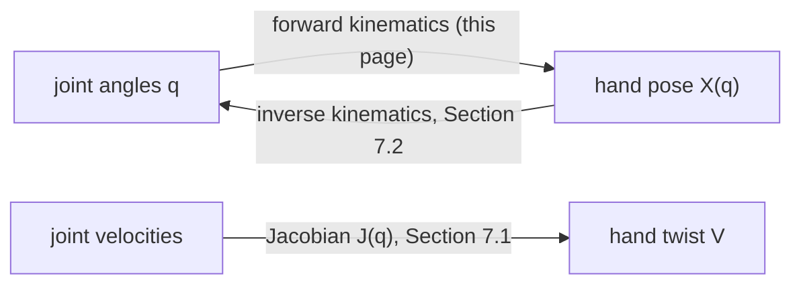

# 7. Manipulator Kinematics
{: .no_toc }

<p class="rlb-meta">Prerequisites: linear algebra, the cross product. No earlier chapter is needed.</p>

1. TOC
{:toc}

## Why a learning book needs kinematics

Every policy in Chapters 3 and 5 outputs numbers that some lower layer turns into motor commands. When the action is an end effector pose, that layer solves inverse kinematics. When the action is a joint position, the policy has learned the inverse kinematics implicitly, and its failures near singularities are kinematic failures. This chapter and the next build that lower layer from first principles, for serial manipulator arms only. Kinematics describes motion without mass or force. Dynamics, in Chapter 8, adds them [3]. The treatment follows Tedrake [1], the ETH Robot Dynamics notes [2] and Lynch and Park [5].

A serial manipulator is a chain of rigid **links** joined by **joints**. We only treat revolute joints, which rotate about a fixed axis, since every joint of the arms we care about is revolute. With $$n$$ joints the **configuration** is the vector of joint angles $$q \in \R^n$$. The **task** is usually the pose of the hand, a position and an orientation, which has 6 degrees of freedom. An arm with $$n > 6$$ is **redundant**. The 7 joint arms used in most labs, such as the KUKA LBR iiwa and the Franka Panda, have one extra degree of freedom, and Section 7.2 shows what it buys.



## Rotations

### Why 9 numbers for 3 degrees of freedom

Attach a frame, three orthonormal axes, to a rigid body. The orientation of frame $$B$$ seen from frame $$A$$ is the matrix $${}^AR^B$$ whose columns are the axes of $$B$$ written in $$A$$ coordinates. Orthonormal columns give $$R^\top R = I$$, six independent constraints on nine entries, which leaves three degrees of freedom. A right handed frame adds $$\det R = +1$$. The set of such matrices is the special orthogonal group $$SO(3)$$.

We use the monogram notation of Tedrake [1]. $${}^AR^B$$ is read "the rotation of $$B$$ measured from $$A$$". Rotations compose when the inner letters match, $${}^AR^B\,{}^BR^C = {}^AR^C$$, and the inverse is the transpose, $$({}^AR^B)^{-1} = {}^BR^A = ({}^AR^B)^\top$$.

### Rotation about an axis, from the cross product

Spin a point $$p$$ about a unit axis $$\omega$$ through the origin at unit angular rate. Its velocity is perpendicular to both the axis and the point, $$\dot p = \omega \times p$$. Write the cross product as a matrix product with the skew symmetric matrix

$$
[\omega] = \begin{bmatrix} 0 & -\omega_3 & \omega_2 \\ \omega_3 & 0 & -\omega_1 \\ -\omega_2 & \omega_1 & 0 \end{bmatrix},
\qquad \omega \times p = [\omega]\,p .
$$

The equation $$\dot p = [\omega] p$$ is linear with a constant matrix, so its solution after rotating by $$\theta$$ is a matrix exponential, $$p(\theta) = e^{[\omega]\theta} p(0)$$. Because $$[\omega]^3 = -[\omega]$$ for a unit axis, the power series collapses to three terms. This is **Rodrigues' formula**.

$$
R = e^{[\omega]\theta} = I + \sin\theta\,[\omega] + (1 - \cos\theta)\,[\omega]^2
\tag{7.1}\label{eq:rodrigues}
$$

The pair $$(\omega, \theta)$$, or the single vector $$\omega\theta \in \R^3$$, are the **exponential coordinates** of $$R$$. The inverse map, the matrix logarithm, recovers $$\omega\theta$$ from $$R$$. It is how we measure orientation error in Section 7.2.

### Choosing a representation

| Representation | Numbers | Problem |
|:--|:--:|:--|
| Rotation matrix | 9 | Redundant. Numerical drift breaks orthogonality |
| Euler or roll pitch yaw angles | 3 | Singular at gimbal lock, the map to angular velocity loses rank |
| Unit quaternion | 4 | $$q$$ and $$-q$$ are the same rotation, so distances need care |
| Exponential coordinates $$\omega\theta$$ | 3 | Singular at $$\theta = \pi$$, fine for small errors |

Any three number representation of $$SO(3)$$ has a singularity somewhere. This is a property of the rotation group itself, and no cleverer formula avoids it [12]. Use matrices or quaternions for storage and exponential coordinates for small differences.

## Rigid body transforms

A pose combines a rotation and a translation. Pack both in a $$4 \times 4$$ homogeneous matrix, an element of the special Euclidean group $$SE(3)$$.

$$
{}^AX^B = \begin{bmatrix} {}^AR^B & {}^Ap^B \\ 0 & 1 \end{bmatrix},
\qquad
{}^AX^B\,{}^BX^C = {}^AX^C,
\qquad
({}^AX^B)^{-1} = \begin{bmatrix} ({}^AR^B)^\top & -({}^AR^B)^\top\,{}^Ap^B \\ 0 & 1 \end{bmatrix}
\tag{7.2}\label{eq:se3}
$$

The inverse is not the transpose. Positions add, but velocities do not add as simply. A point fixed in a moving frame picks up a term $$\omega \times p$$ from the rotation of that frame [1]. This term is the origin of every cross product in the rest of the chapter.

### Twists and screws

The velocity of a rigid body is a pair, an angular velocity $$\omega$$ and a linear velocity $$v$$. Stack them as a **twist** $$\mathcal{V} = (\omega, v) \in \R^6$$, angular part first, as in [1] and [5]. Chasles' theorem [11] says every rigid motion is a rotation about some line combined with a translation along it, which is a screw motion. A revolute joint is the simplest screw. If its axis has direction $$\omega$$ and passes through a point $$p$$, rotating at unit rate moves the point of the body currently at the origin with velocity $$v = -\omega \times p$$. The joint's **screw axis** is

$$
\mathcal{S} = \begin{bmatrix} \omega \\ -\omega \times p \end{bmatrix}.
\tag{7.3}\label{eq:screw}
$$

As with rotations, rotating about the screw by $$\theta$$ is a matrix exponential, now of the $$4 \times 4$$ matrix $$[\mathcal{S}] = \begin{bmatrix} [\omega] & v \\ 0 & 0 \end{bmatrix}$$. The closed form is `exp_se3` in `kin_core.py` below [5].

To move a twist from one frame to another, use the $$6 \times 6$$ **adjoint** of the transform between them.

$$
\mathrm{Ad}_X = \begin{bmatrix} R & 0 \\ [p]R & R \end{bmatrix},
\qquad \mathcal{V}_A = \mathrm{Ad}_{\,{}^AX^B}\,\mathcal{V}_B
\tag{7.4}\label{eq:adjoint}
$$

## Forward kinematics

Forward kinematics is the map $$q \mapsto X(q)$$ from joint angles to the hand pose. Two parameterisations dominate.

### Denavit Hartenberg

Denavit and Hartenberg place one frame on each link with strict rules, the $$z$$ axis along the joint axis and the $$x$$ axis along the common normal to the next joint axis [9]. The transform between consecutive frames then needs only four numbers [6, 9].

$$
{}^{i-1}X^{i} = \mathrm{Rot}_z(q_i)\,\mathrm{Trans}_z(d_i)\,\mathrm{Trans}_x(a_i)\,\mathrm{Rot}_x(\alpha_i),
\qquad
X(q) = {}^{0}X^{1}\,{}^{1}X^{2} \cdots {}^{n-1}X^{n}
\tag{7.5}\label{eq:dh}
$$

Our running example is a 7 joint arm with the link lengths of the LBR iiwa 14 [13]. The axes alternate between vertical and horizontal, and all offsets $$a_i$$ are zero.

| Joint $$i$$ | 1 | 2 | 3 | 4 | 5 | 6 | 7 |
|:--|:--:|:--:|:--:|:--:|:--:|:--:|:--:|
| $$d_i$$ [m] | 0.36 | 0 | 0.42 | 0 | 0.40 | 0 | 0.126 |
| $$\alpha_i$$ | $$-\pi/2$$ | $$\pi/2$$ | $$\pi/2$$ | $$-\pi/2$$ | $$-\pi/2$$ | $$\pi/2$$ | 0 |
| limit [deg] | 170 | 120 | 170 | 120 | 170 | 120 | 175 |

### Product of exponentials

Brockett's product of exponentials needs no link frames at all [10]. Put the arm at $$q = 0$$ and record two things, the hand pose $$M$$ and the screw axis $$\mathcal{S}_i$$ of every joint, all in the base frame. Now move the joints one at a time, starting from the last. Rotating joint $$n$$ by $$q_n$$ moves the hand by $$e^{[\mathcal{S}_n] q_n}$$. Rotating joint $$n-1$$ then carries joint $$n$$ and the hand along rigidly, so it multiplies on the left. Repeating down the chain gives

$$
X(q) = e^{[\mathcal{S}_1] q_1}\, e^{[\mathcal{S}_2] q_2} \cdots e^{[\mathcal{S}_n] q_n}\, M .
\tag{7.6}\label{eq:poe}
$$

The order matters. Each exponential is written in the base frame, which is only valid because every joint further out is still at its zero position when that factor is applied.

| | Denavit Hartenberg | Product of exponentials |
|:--|:--|:--|
| Parameters per joint | 4, after placing frames by rule | 6 (a screw axis), read off the zero pose |
| Link frames needed | yes | only base and hand |
| Ambiguity | several valid frame choices | none |
| Calibration | parameters jump near parallel axes | smooth in all parameters |
| Where you meet it | datasheets, older code | Lynch and Park [5], Murray et al. [8] |

A third bookkeeping, the elementary transform sequence, writes the chain as a plain list of unit rotations and translations with no frame rules at all [7]. It is what the Robotics Toolbox for Python uses.

## Implementation

`kin_core.py` implements both. `screw_axes` derives the PoE axes from the DH frames at $$q = 0$$, the $$z$$ axis of frame $$i-1$$ through the origin of frame $$i-1$$.



The first part of `ch07_kinematics.py` prints the screw axes and checks that the two parameterisations give the same map.

```text
screw axes S_i = (w_i, v_i) at q = 0:
[[ 0.    0.    1.   -0.   -0.   -0.  ]
 [ 0.    1.    0.   -0.36 -0.   -0.  ]
 [ 0.    0.    1.   -0.   -0.   -0.  ]
 [ 0.   -1.    0.    0.78 -0.   -0.  ]
 [ 0.    0.    1.   -0.   -0.   -0.  ]
 [ 0.    1.    0.   -1.18 -0.   -0.  ]
 [ 0.    0.    1.   -0.   -0.   -0.  ]]
home pose M:  identity rotation, hand at z = 1.306 m
max |FK_PoE - FK_DH| over 1000 configs: 6.66e-16
```

Read the second row. Joint 2 rotates about the $$y$$ axis through the point $$(0, 0, 0.36)$$. Equation \eqref{eq:screw} gives $$v = -\omega \times p = -(0,1,0) \times (0,0,0.36) = (-0.36, 0, 0)$$, which is what the code printed. At $$q = 0$$ the arm points straight up, and the hand sits at $$0.36 + 0.42 + 0.40 + 0.126 = 1.306$$ m.

{: .key }
> Forward kinematics is a product of rigid transforms. DH and PoE are two bookkeeping schemes for the same product, and they agree to machine precision. PoE is easier to get right because every quantity is read off one picture of the arm at $$q = 0$$.

{: .warning }
> Datasheets mix two DH conventions, the classic one used here and the modified one of Craig [4], which applies $$\mathrm{Rot}_x(\alpha_{i-1})$$ and $$\mathrm{Trans}_x(a_{i-1})$$ **before** the joint rotation. A table copied into the wrong convention still produces a plausible looking arm. Always check a few configurations against a URDF or a simulator before trusting it.

{: .exercise }
> Change the sign of $$\alpha_4$$ in `DH_ALPHA` and rerun. Which screw axis changes, and why does the elbow now bend the other way for the same $$q_4$$?

## References

1. R. Tedrake. *Robotic Manipulation: Perception, Planning, and Control.* Course notes for MIT 6.4210, 2024. Chapter "Basic Pick and Place". [manipulation.mit.edu/pick.html](https://manipulation.mit.edu/pick.html)
2. Robotic Systems Lab, ETH Zurich (M. Hutter et al.). *Robot Dynamics Lecture Notes.* HS 2017. [PDF](https://ethz.ch/content/dam/ethz/special-interest/mavt/robotics-n-intelligent-systems/rsl-dam/documents/RobotDynamics2017/RD_HS2017script.pdf)
3. G. Zardini, J. Lorenzetti, M. Pavone. *Principles of Robot Autonomy.* Stanford lecture notes, 2024. Chapter 1. [PDF](https://stanfordasl.github.io/PoRA-I/aa174a_aut2425/pdfs/AA_PoRA_lecture_notes_2425.pdf)
4. J. J. Craig. *Introduction to Robotics: Mechanics and Control.* 3rd edition, Pearson, 2005.
5. K. M. Lynch, F. C. Park. *Modern Robotics: Mechanics, Planning, and Control.* Cambridge University Press, 2017. Chapters 3 and 4. [modernrobotics.org](http://modernrobotics.org)
6. B. Siciliano, L. Sciavicco, L. Villani, G. Oriolo. *Robotics: Modelling, Planning and Control.* Springer, 2009. Chapter 2.
7. J. Haviland, P. Corke. *Manipulator Differential Kinematics, Part I: Kinematics, Velocity, and Applications.* IEEE Robotics and Automation Magazine, 2023. [arXiv:2207.01796](https://arxiv.org/abs/2207.01796)
8. R. M. Murray, Z. Li, S. S. Sastry. *A Mathematical Introduction to Robotic Manipulation.* CRC Press, 1994.
9. J. Denavit, R. S. Hartenberg. *A Kinematic Notation for Lower-Pair Mechanisms Based on Matrices.* Journal of Applied Mechanics 22(2), 1955.
10. R. W. Brockett. *Robotic Manipulators and the Product of Exponentials Formula.* Mathematical Theory of Networks and Systems, Springer, 1984.
11. M. Chasles. *Note sur les propriétés générales du système de deux corps semblables entr'eux.* Bulletin des Sciences Mathématiques 14, 1830.
12. J. Stuelpnagel. *On the Parametrization of the Three-Dimensional Rotation Group.* SIAM Review 6(4), 1964.
13. KUKA. *LBR iiwa 7 R800, LBR iiwa 14 R820 Specification.* KUKA Roboter GmbH, 2016. The link lengths used here also appear in the public `iiwa14` description of the Drake model collection.
